# SlicerRemoteView architecture

Status: design document written by `architect` on 2026-10-17 for protocol `1.0` (`docs/protocol.md` is the
contract; this document explains how the components realise it). Owned by `release` on `main` (CLAUDE.md
rule 4). Facts about external technology come from `docs/research/{slicer,relay,web,quest}.md`, cited as
`slicer.md §n` etc. Requirements are referenced generically (see `docs/requirements.md`). Section 8 is the
**canonical threat model** — other documents link here instead of restating rules. `[TODO verify]` marks
design points that still need a measurement or vendor confirmation.

## 1. System context and components

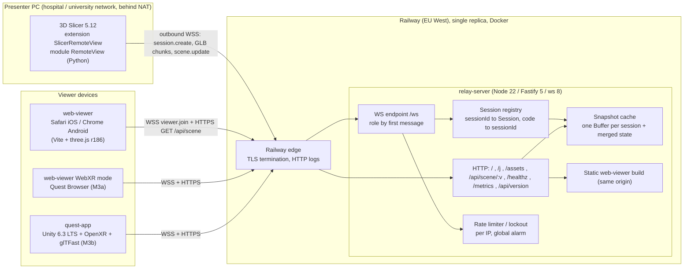

| Component | Responsibility | Does not |
|---|---|---|
| Slicer extension (`slicer-plugin/`) | observe MRML, decimate, write GLB, send snapshots and updates, show code + QR, resume with `publisherToken` | open inbound ports; write network data to disk |
| relay (`relay-server/`) | codes, sessions, auth tokens, fan-out, snapshot cache, rate limits, static viewer, health/metrics | parse GLB, persist anything, log payloads, scale beyond one replica |
| web-viewer (`web-viewer/`) | join by code or `/j#CODE`, fetch/stream GLB, render, node list UI, local camera, optional WebXR | send geometry; store codes beyond the session |
| quest-app (`quest-app/`) | same as web-viewer natively (glTFast, XRI, passthrough) | — |
| shared (`shared/`) | JSON Schema + generated TS/Python/C# types, GLB fixtures | runtime logic |

## 2. Sequence diagrams

### 2.1 Start session

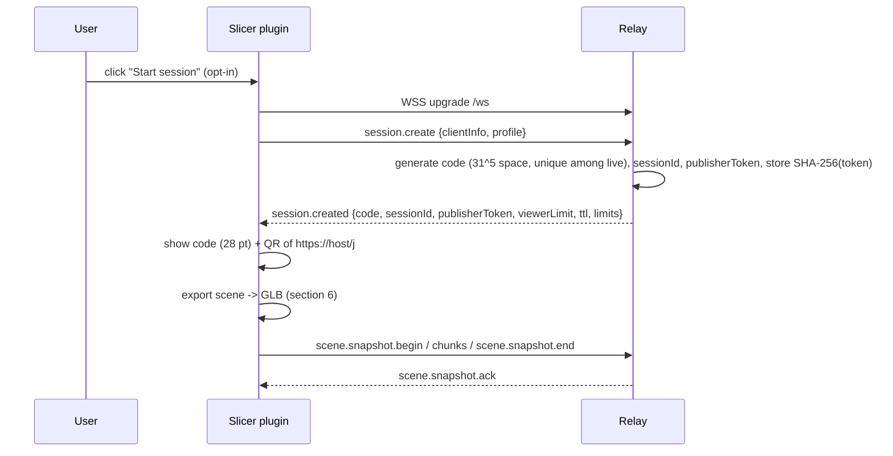

### 2.2 Device join — typed code and QR deep link

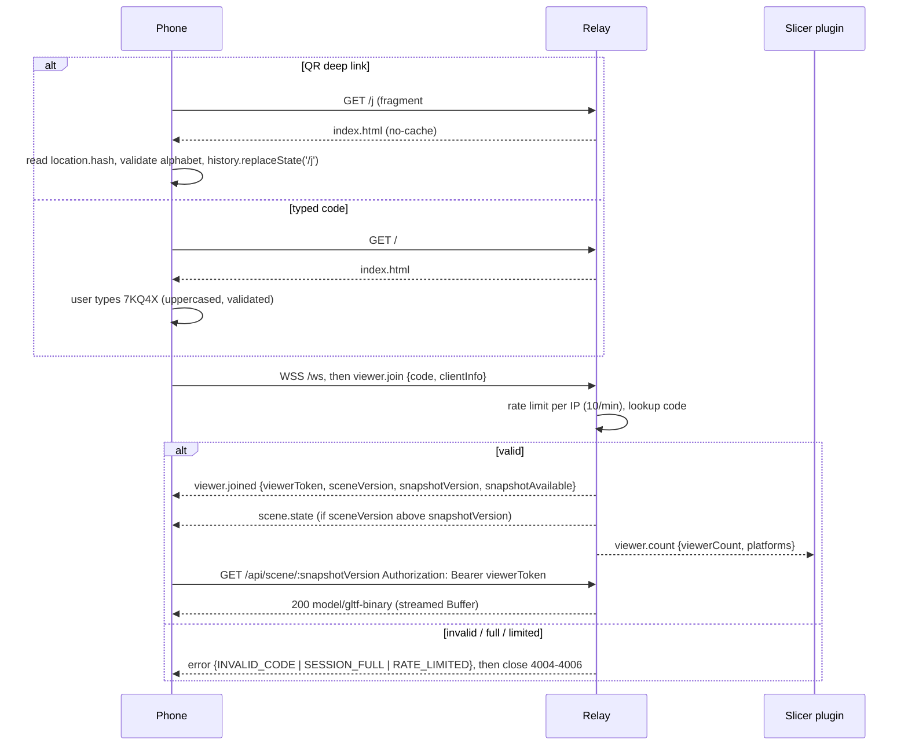

### 2.3 Snapshot transfer with fan-out

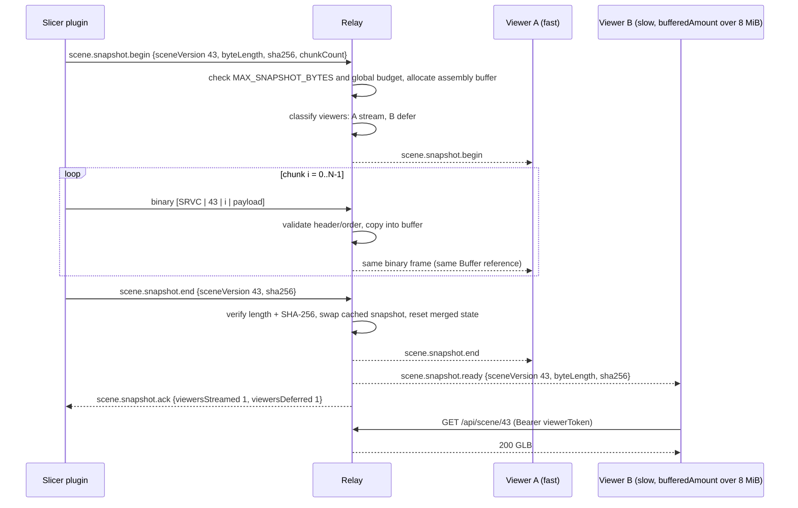

### 2.4 Incremental update

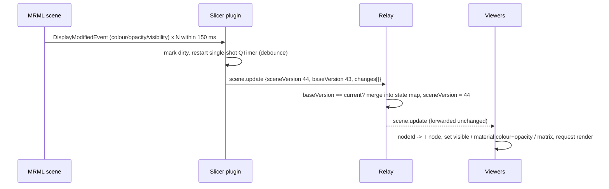

### 2.5 Late join (cached snapshot)

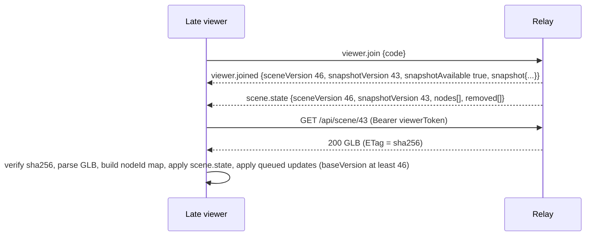

### 2.6 Viewer disconnect and reconnect

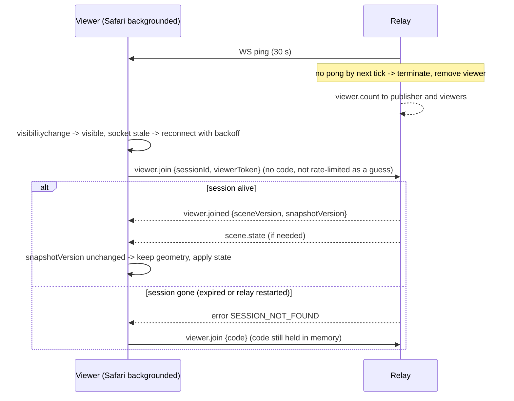

### 2.7 Publisher disconnect and resume, including relay redeploy (SIGTERM draining)

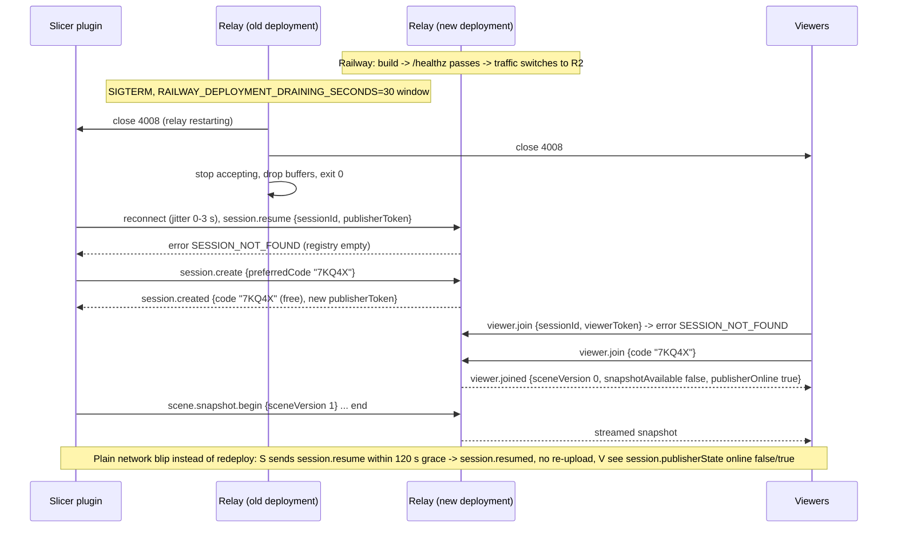

### 2.8 Session expiry

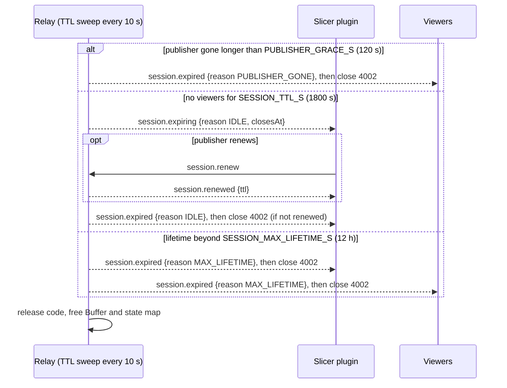

### 2.9 Session end by Slicer

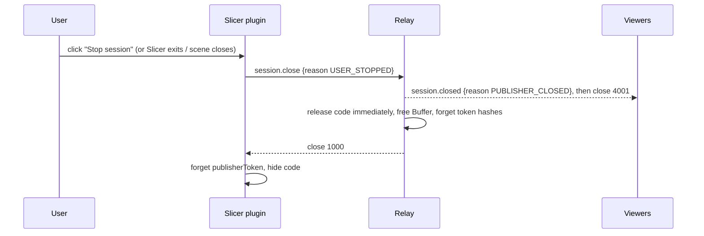

## 3. Session data model and code lifecycle

```ts
interface Session {
  id: string;                       // "sess_" + 16 random base32 chars; internal, loggable
  code: string;                     // 5 chars from 23456789ABCDEFGHJKMNPQRSTUVWXYZ; never logged
  phase: "allocated" | "active" | "grace" | "closed" | "expired";
  publisher?: WebSocket;            // undefined while in grace
  publisherTokenHash: Uint8Array;   // SHA-256 of publisherToken; raw token never stored
  profile: "mobile" | "quest2" | "quest3";
  createdAt: number; lastPublisherSeen: number; lastViewerActivity: number; expiresAt: number;
  sceneVersion: number;             // last accepted version (snapshot or update)
  snapshot?: { buffer: Buffer; sha256: string; byteLength: number; sceneVersion: number };
  assembling?: { buffer: Buffer; sceneVersion: number; expected: number; nextChunk: number; lastChunkAt: number };
  nodeState: Map<string, NodeState | "removed">; // merged scene.update / scene.nodeRemoved since snapshot
  viewers: Map<string, Viewer>;     // key: viewerId
  limits: { maxViewers: number; maxSnapshotBytes: number };
  joinFailures: number;             // per-session counter for metrics only
}
interface NodeState { visible?: boolean; color?: [number, number, number]; opacity?: number; matrix?: number[] }
interface Viewer {
  id: string;                       // "vw_" + 4-8 random chars (safe to log)
  tokenHash: Uint8Array;            // SHA-256 of viewerToken
  socket?: WebSocket;               // undefined after drop until rejoin (entry kept until session ends)
  joinedAt: number; lastSeen: number;
  platform: "web" | "quest-browser" | "quest2" | "quest3" | "other";
  streaming?: number;               // sceneVersion currently being streamed to this viewer
  watermarks: { softBytes: 8 * 2 ** 20; hardBytes: 32 * 2 ** 20; stuckMs: 60_000 }; // bufferedAmount policy
  sceneRequests: number;            // throttle scene.request to 1 per 5 s
}
interface Registry {
  byId: Map<string, Session>; byCode: Map<string, string>;           // code -> sessionId
  viewerTokens: Map<string /*hash hex*/, { sessionId: string; viewerId: string }>;
  ipJoinWindow: Map<string /*hashed ip*/, { count: number; windowStart: number; failures: number; bannedUntil?: number }>;
  totalSnapshotBytes: number;                                         // vs MAX_TOTAL_SNAPSHOT_BYTES
}
```

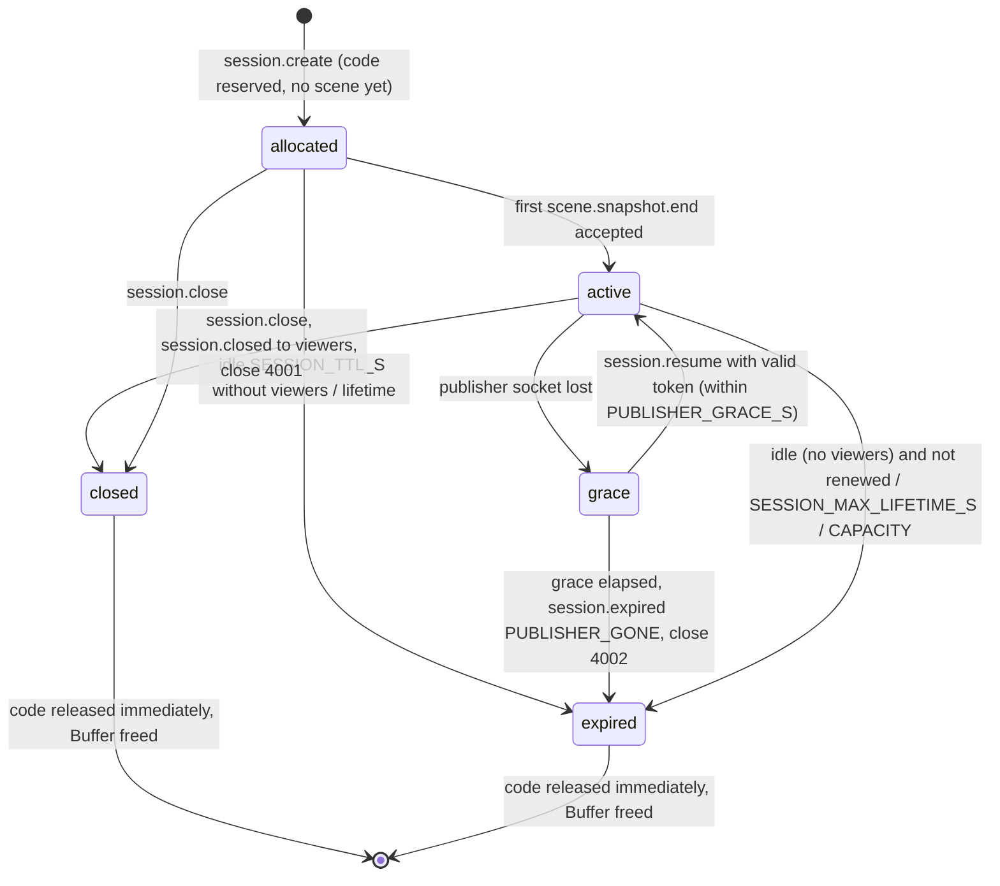

Code allocation: `crypto.randomInt(31)` per symbol, retry on collision with `byCode` (collision probability
with 1,000 live sessions ≈ 3.5e-5 per draw, relay.md §4). `preferredCode` is honoured only when absent from
`byCode`. There is no cooldown on reuse: a freed code may be reissued immediately, which is acceptable because a
viewer that types a stale code sees a different presenter's *empty or current* scene only if that presenter's
session is live and the viewer limit allows — the residual risk is listed in section 8 (T1).

## 4. Limits and budgets

| Limit | Value | Where set | Justification (research) |
|---|---|---|---|
| Viewers per session | 20 (`MAX_VIEWERS`) | relay env | one lecture room / one ward round; 20 × 32 MiB = 640 MiB egress per snapshot ≈ $0.03 at $0.05/GB (relay.md §1.7); fan-out CPU is header-only per socket (relay.md §3) |
| Snapshot hard cap | 64 MiB (`MAX_SNAPSHOT_BYTES`) | relay env; protocol max | 1 M quantized triangles ≈ 20–30 MiB `[TODO verify]` with real exports; Quest 3 profile ceiling (quest.md §7) |
| Snapshot recommended, `mobile`/`quest2` | ≤ 32 MiB | publisher decimation | Safari WebContent limit ≈ 1.5 GB; peak ≈ GLB + parsed copies + GPU ≈ 4× (web.md §2) |
| Per-session relay memory | ≤ 2 × snapshot (cached + assembling) + state map (< 1 MiB) | design | the assembling buffer replaces the cached one atomically at `scene.snapshot.end` |
| Global snapshot budget | `MAX_TOTAL_SNAPSHOT_BYTES` = 512 MiB default | relay env | ≈ 50 % of a 1 GiB container; `Buffer`s are off-heap so `--max-old-space-size` does **not** bound them — the application budget is the real guard (relay.md §6) |
| Max sessions | `MAX_SESSIONS` = 100 default | relay env | 100 × typical 10–20 MiB fits the budget; also bounds the live-code population `S` |
| Text message | 256 KiB publisher / 16 KiB viewer | relay | protocol §3.3 |
| Binary chunk | 1 MiB + 12 B; `ws maxPayload` 1 MiB + 64 KiB | relay | one server-wide `maxPayload` in `@fastify/websocket` (relay.md §2); browser WS message limits undocumented (web.md §5) |
| Heartbeat | client `ping` 15 s / `pong` 10 s; relay WS ping 30 s | protocol | browsers cannot send pings; Railway has no WS idle timeout but NATs do (relay.md §1.3) |
| Publisher grace | 120 s (`PUBLISHER_GRACE_S`) | relay env | covers Wi-Fi roaming and the 30 s drain window |
| Idle TTL (no viewers) | 1,800 s (`SESSION_TTL_S`) | relay env | anti-guessing: keep `S` small; renewable |
| Max lifetime | 43,200 s (`SESSION_MAX_LIFETIME_S`) | relay env | memory hygiene; a lecture day |
| Join attempts | 10/min/IP; ban 10 min after 20 failures/10 min; global alarm 1,000/h | relay | relay.md §4; protocol §12 |
| Container memory target | 1 GiB (Railway vertical autoscale capped by budget) | deploy | $10/GB-month (relay.md §1.7); `NODE_OPTIONS=--max-old-space-size-percentage=75` for the heap |
| Triangle budgets | 500 k (`mobile`, `quest2`), 1 M (`quest3`) | publisher | Meta: Quest 2 < 750 k, Quest 3 < 1.5 M tris/frame (quest.md §7); headroom for hands/UI |

## 5. Relay internals

- **Process model:** one Node 22 process, one replica (Railway load-balances randomly, no sticky sessions,
  relay.md §1.7). Fastify 5 + `@fastify/websocket` 11 share the HTTP server; hooks (rate limit, origin check)
  run before the upgrade. `message` listeners are wrapped in try/catch because plugin-level error handlers do
  not see them (relay.md §2).
- **Message handling:** parse envelope → validate with the shared JSON Schema (precompiled Ajv) → check
  `protocolVersion` major → check permissions matrix for the socket's role → dispatch. Binary frames: check
  role = publisher, parse 12-byte header, check `sceneVersion == assembling.sceneVersion` and
  `chunkIndex == nextChunk`, copy into `assembling.buffer`, forward the same frame to viewers marked
  `streaming`. The relay never decodes GLB content.
- **Fan-out and backpressure:** one `Buffer` per snapshot, same reference passed to every `send()` (`ws`
  only prepends a frame header, relay.md §3). Before `begin`, viewers with `bufferedAmount` > 8 MiB are
  deferred to `scene.snapshot.ready`; during streaming a viewer crossing 32 MiB or stuck > 60 s is closed with
  `4010`. Publisher reading is paused (`socket.pause()` on the stream) while `totalSnapshotBytes` plus
  in-flight exceeds the global budget.
- **Snapshot cache:** latest complete snapshot only; `GET /api/scene/:v` serves it with
  `Content-Length` and `ETag` and lets Node's HTTP stream handle backpressure. `404` for any other version.
- **State map:** merged `scene.update`/`scene.nodeRemoved`, sent as `scene.state` to late joiners; reset on
  each accepted snapshot; bounded by node count (≤ 1,000 nodes × ~300 B).
- **TTL sweep:** every 10 s; transitions per the state machine; releasing a session drops every reference so
  V8/GC frees the `Buffer` (no pooling or reuse of buffers that held scene bytes).
- **Logging:** pino JSON lines with `redact` on `code`, `*.code`, `publisherToken`, `viewerToken`, `*.token`,
  `req.headers.authorization`; per-request logging disabled; only `sessionId`, `viewerId`, byte counts,
  durations, close codes, error codes and an HMAC of the client IP (per-boot key) are logged (relay.md §5).
- **Shutdown:** on SIGTERM stop accepting upgrades, return `503` from `/healthz`, send close `4008` to every
  socket, wait for sends to flush (≤ 5 s), exit. `RAILWAY_DEPLOYMENT_DRAINING_SECONDS=30` gives the window
  (default is 0 s → SIGKILL, relay.md §1.8). Image uses `dumb-init` so SIGTERM reaches Node.

## 6. Slicer-side pipeline

```
MRML observers (main thread)  ->  dirty set + debounce  ->  change set
   -> geometry changed?  yes -> full export: visible nodes -> closed surfaces -> decimation (profile budget)
                                 -> RAS mm -> glTF m Y-up -> GLB writer (numpy + struct) -> chunk -> IO thread
                        no  -> scene.update / scene.nodeRemoved (JSON)                          -> IO thread
```

1. **Observers** (`slicer.util.VTKObservationMixin`): scene `NodeAddedEvent`/`NodeRemovedEvent`,
   displayable `DisplayModifiedEvent`, model `MeshModifiedEvent`, `TransformModifiedEvent`, segmentation
   `SegmentAdded/Removed/Modified/RepresentationModified`, display node `ModifiedEvent`. Skip while
   `IsImporting()`/`IsBatchProcessing()`, flush on `EndImportEvent`/`EndBatchProcessEvent`; on
   `EndCloseEvent` start a new snapshot (all IDs change) (slicer.md §2–3).
2. **Debounce:** handlers only set `dirty[nodeId] |= flags` and restart one single-shot `qt.QTimer`
   (150 ms for appearance, 750 ms for mesh/segment edits). The timer drains the set into a change set.
3. **Classification:** appearance/transform-only → `scene.update` (`matrix` from
   `GetMatrixTransformToWorld`, converted to glTF space `C·M·C⁻¹`); removed nodes → `scene.nodeRemoved`;
   new node, mesh change, non-linear transform change, or scene reload → **full export** (v1 has no partial
   geometry). `scene.nodeAdded` is sent first as a UI hint.
4. **Export (main thread, VTK):** per visible model/segment: `GetPolyData()` or
   `vtkSlicerSegmentationsModuleLogic.GetSegmentClosedSurfaceRepresentation(..., applyParentTransform=False)`
   (parent transform goes into `T.matrix`; non-linear → bake with `vtkTransformPolyDataFilter`, `baked:true`),
   `vtkTriangleFilter` → `vtkQuadricDecimation` to the per-node share of the profile budget (proportional to
   input triangle count, min 2 k per node; fallback `vtkDecimatePro(PreserveTopologyOn)` if degenerate) →
   `vtkPolyDataNormals(SplittingOff)` → numpy copies (`np.array(copy=True)`), one node per timer tick with a
   progress dialog so the GUI stays responsive (slicer.md §5, §8).
5. **GLB writer (pure Python + numpy, no Slicer imports — testable in CI):** apply `[R,S,-A]×0.001`, quantize
   `POSITION` to `SHORT` with per-mesh scale/offset in `M.matrix`, `NORMAL` as normalised `BYTE` (stride 4),
   indices `uint16`/`uint32`, one material per node, extras per protocol §7. Validated in CI with
   `gltf-validator` on fixtures shared with `tools/fake-slicer`.
6. **Send (IO thread):** `websockets.sync.client` in a `threading.Thread`; outbound `queue.Queue` of
   `(text | bytes)`; GLB sliced into 1 MiB chunks with the `SRVC` header; SHA-256 computed on the IO thread
   from the bytes copy. Inbound messages go to a `queue.Queue` drained by a main-thread `qt.QTimer`
   (50–100 ms) that also yields (`time.sleep(0.001)`) so the worker gets the GIL (slicer.md §3). Reconnect with
   backoff; on reconnect `session.resume`, else `session.create{preferredCode}`.
7. **Main-thread rules:** only the main thread touches MRML/VTK/Qt; never `HardenTransform()`; no pip install
   or heavy import at module load — `slicer.packaging.pip_ensure` for `websockets` and `segno` on the first
   "Start session" click (slicer.md §6, Extension Index opt-in rule §1).

## 7. Viewer-side pipeline (web and Quest)

```
viewer.join -> viewer.joined -> [GET /api/scene/:v | streamed chunks] -> reassemble (preallocated byteLength)
  -> verify sha256 -> parse GLB -> map extras.nodeId -> T node -> apply scene.state + queued updates
  -> render on demand (web) / per frame (XR)
```

- **Reassembly:** allocate one `Uint8Array(byteLength)` / `byte[]`, copy chunk payloads at
  `chunkIndex × chunkSize`, reject header mismatches (`BAD_SEQUENCE` → `scene.request`). For HTTP, read the
  body as a stream for progress; `Content-Length` must equal the announced `byteLength`.
- **Verify:** `crypto.subtle.digest('SHA-256')` (web) / `SHA256.HashData` (Unity); mismatch → discard,
  `scene.request{reason:"CHECKSUM_MISMATCH"}`.
- **Parse:** web — `GLTFLoader.parse(arrayBuffer, '')` with no Draco/meshopt decoder in v1 (quantization is
  native via `normalized` attributes, web.md §1.3); Quest — `GLTFast.Newtonsoft.GltfImport.Load(byte[])` with
  `TimeBudgetPerFrameDeferAgent`, read `extras.nodeId` in `NodeCreated` (quest.md §4). Reject GLBs that
  violate protocol §7 (external URIs, textures, > 1 scene, missing root extras) before instantiation.
- **Mapping:** `Map<nodeId, {T, M, material}>`; `T.visible`, `T.matrix` ← updates; `M.material` cloned per
  node (glTFast shares materials per glTF material index; three.js materials are per primitive already).
  Updates arriving before the GLB is ready are queued and applied in order after `scene.state`.
- **Transparency:** `transparent = opacity < 1`, `depthWrite = false` for translucent nodes, stable
  `renderOrder` by manifest order (web.md §1.6); Quest: warn above ~5 translucent nodes (quest.md §7).
- **Render on demand** (web 2D): render only on `controls.change`, update, resize, visibility; stop when
  `document.hidden`. WebXR/Unity render every frame.
- **Disposal:** on a new snapshot or `scene.nodeRemoved`: traverse old nodes, `geometry.dispose()`,
  `material.dispose()`, remove from scene, drop the received `ArrayBuffer` reference immediately after parse
  (web.md §1.4, §2.2); Unity: `GltfImport.Dispose()` after instantiating the replacement. Check
  `renderer.info.memory` in dev builds. Handle `webglcontextlost`/`restored` with a status message.
- **Reconnect:** exponential backoff 0.5–30 s with jitter; `visibilitychange → visible` forces a liveness
  check; stop on `4000`, `4001`, `4002`, `4003`, `4004`, `4011`; immediate retry on `4008`.

## 8. Threat model (canonical)

Assets: scene geometry and node names (may be PHI), session codes, publisher/viewer tokens, relay
availability. Trust: TLS to the Railway edge; the relay is trusted to forward but is designed to hold as
little as possible; publishers are semi-trusted (anyone with the extension); viewers are untrusted.

| # | Threat | Vector | Impact | Mitigation | Residual risk |
|---|---|---|---|---|---|
| T1 | Code guessing | brute-force `viewer.join` from one or many IPs | unauthorised viewer sees a live scene | 31^5 space; 10 joins/min/IP, ban after 20 failures, global alarm tightening to 3/min; uniform `INVALID_CODE` with jitter; idle sessions expire; `viewer.count` lets the presenter notice an extra viewer; `MAX_SESSIONS` bounds `S` | distributed attacker with many IPs raises odds (0.2 %/h per IP at S = 100); a stale code reissued to a new session; mitigation: presenter can stop/restart to rotate the code (v1.1: optional 6-char or PIN) |
| T2 | DoS via large blobs | oversized `scene.snapshot.begin`, giant frames, endless chunks, many sessions | relay OOM / eviction, other sessions lost | `ws maxPayload` 1 MiB + 64 KiB (closes `1009` before reading); `MAX_SNAPSHOT_BYTES`, `MAX_TOTAL_SNAPSHOT_BYTES`, `MAX_SESSIONS`; chunk timeout 120 s; `session.create` 5/min/IP; Railway restart policy | an authenticated publisher can still fill its own budget; Railway vertical autoscale bills before OOM — budget caps are the control |
| T3 | DoS via many connections | socket floods, handshake without first message, slow readers | fd/memory exhaustion | upgrade limit 30/min/IP, handshake timeout 10 s (`4012`), slow-consumer close `4010`, `MAX_VIEWERS` 20, Railway ~10 k connections/domain | volumetric attacks are Railway's edge problem; no WAF in v1 |
| T4 | Publisher impersonation | theft/replay of `publisherToken` (resume) or hijack of a free code | attacker replaces the scene viewers see | token ≥ 128 bit random, hashed at rest, only in WS body over TLS, bound to `sessionId`, valid only in `grace`/live, never in URL/logs/disk; `4011` closes the older socket so a hijack is visible to the real publisher | malware on the presenter PC has the token in process memory; accepted |
| T5 | Eavesdropping | network capture between client and edge or edge and container | PHI disclosure | TLS 1.2/1.3 at Railway edge (Let's Encrypt); WSS/HTTPS only; viewer refuses `ws://` outside `localhost`; Slicer client uses `ssl.create_default_context()` and never offers "disable verification" | edge → container hop is Railway-internal; trust in Railway (DPA) `[TODO verify]` for the institution |
| T6 | Leakage via logs, URL paths, fragments, Referer | codes/tokens in edge HTTP logs, pino logs, browser history, screenshots | code/token exposure, re-use | code only in URL **fragment** (`/j#CODE`, never sent); `history.replaceState` removes it; no code/token in any path/query/header except `Authorization` for `/api/scene`; pino `redact`; no request-body logging; `Referrer-Policy: no-referrer`; only `sessionId`/`viewerId` logged | a user screenshotting the QR shares the code (by design); Railway logs may include query strings `[TODO verify]` — moot because nothing secret is ever there |
| T7 | PHI in node names | Slicer node names derived from DICOM (patient name) exported into GLB extras | PHI reaches viewers and relay memory | "Hide node names" option (opt-in, default **off** — `docs/requirements.md` FR-15/NFR-16: students need anatomical labels; the pre-send node list shows what will leave Slicer), sanitisation ≤ 64 chars, no PHI in JSON updates (nodeId only), relay never logs or persists GLB, snapshots freed on session end; user guide warns | presenter may leave names visible; geometry itself (face surface) can be identifying — out of scope, documented |
| T8 | Viewer token replay | captured `viewerToken` reused by another device | extra viewer; GLB download | token ≥ 128 bit, hashed at rest, TLS-only, dies with the session, `/api/scene` 30/min/token, rejoin binds to the same `viewerId` (second concurrent use closes the older socket `4011`) | within a live session a stolen token works; low value and visible in `viewer.count` |
| T9 | Session loss on redeploy / single replica / crash | SIGTERM, OOM, Railway incident | all viewers drop; presentation interrupted | `4008` with drain window; publisher `session.resume` → `session.create{preferredCode}` keeps the code; viewers retry token then code; deploy off-hours; `/healthz` gates traffic switch | seconds of interruption; re-upload of the snapshot (≤ 64 MiB) over the presenter's uplink; no HA by design (ADR-0006) |
| T10 | Malicious GLB from a rogue publisher | crafted GLB targeting viewer parsers (huge accessor counts, external URIs, recursion) | viewer crash/OOM, SSRF via `uri` | size caps (`MAX_SNAPSHOT_BYTES`, per-profile), SHA-256 integrity, viewer pre-validation of protocol §7 rules (no `uri`, no images, one scene, bounded node count), `GLTFLoader.parse` with `path = ''` and no external loaders, Unity `GltfImport` with `uri = null`; parse in try/catch, surface `error` UI | parser bugs in three.js/glTFast; mitigated by pinning versions and updating; viewer fuzz tests in `qa` |
| T11 | Cross-session data mixing | relay bug routes a chunk/update to the wrong session; stale `Buffer` reuse | PHI disclosure to the wrong audience | per-socket `sessionId` fixed at the first message; chunk header carries `sceneVersion`; no shared buffer pools; property-based tests on the registry; `sessionId` in every relay→client control message so clients drop mismatches | implementation defects; covered by `qa` E2E with two concurrent sessions |
| T12 | Dependency supply chain | compromised npm/PyPI/UPM package | code execution on relay, viewer or presenter PC | pinned exact versions + lockfiles, `npm ci`, Dependabot/Renovate, `npm audit` in CI, minimal Alpine image, `USER node`, no native add-ons; Slicer deps limited to `websockets`, `segno`, installed only after user consent; Unity packages from Unity registry only | zero-days; review of upgrades is manual |

Non-goals in v1: end-to-end encryption between publisher and viewers (relay sees plaintext), user accounts,
audit logging of who viewed what. Revisit if a deployment handles identified patient data rather than
teaching/anonymised cases.

## 9. Deployment view

- **Image:** single multi-stage Dockerfile at `relay-server/Dockerfile`, build context = repo root with a root
  `.dockerignore` (ADR-0007) so stage 1 can `npm ci` the workspaces, `tsc` the relay and Vite-build
  `web-viewer`; stage 2 is `node:22-alpine` + `dumb-init`, `USER node`, `CMD ["dumb-init","node","dist/index.js"]`,
  production `node_modules` only, `web-viewer/dist` copied to `relay-server/public`.
- **Railway:** one service, **single replica**, EU West region (`europe-west4-drams3a`, Hobby availability
  `[TODO verify]`), serverless/app-sleeping **off**, no volume, IaC in `.railway/railway.ts` (config-as-code is
  deprecated from 2026-12-01, relay.md §1.2), healthcheck path `/healthz`, restart policy on failure.
- **Environment variables** (identical names in `docs/protocol.md`, `.railway/railway.ts`, `relay-server/README.md`):

| Variable | Default | Meaning |
|---|---|---|
| `PORT` | injected by Railway | listen port, `0.0.0.0` |
| `LOG_LEVEL` | `info` | pino level |
| `METRICS_TOKEN` | unset → `/metrics` disabled (404) | bearer for Prometheus scrape |
| `SESSION_TTL_S` | `1800` | idle TTL without viewers |
| `PUBLISHER_GRACE_S` | `120` | resume window after publisher drop |
| `SESSION_MAX_LIFETIME_S` | `43200` | hard cap per session |
| `MAX_SNAPSHOT_BYTES` | `67108864` | per-snapshot cap (protocol max) |
| `MAX_TOTAL_SNAPSHOT_BYTES` | `536870912` | global cached + assembling budget |
| `MAX_VIEWERS` | `20` | per session |
| `MAX_SESSIONS` | `100` | live sessions |
| `ALLOWED_ORIGINS` | `https://${RAILWAY_PUBLIC_DOMAIN}` | browser `Origin` allow-list for `/ws` |
| `NODE_OPTIONS` | `--max-old-space-size-percentage=75` | heap cap relative to container memory `[TODO verify]` cgroup awareness (relay.md §6) |
| `RAILWAY_DEPLOYMENT_DRAINING_SECONDS` | `30` (Railway default 0) | SIGTERM → SIGKILL window for `4008` drain |

- **Healthcheck:** `GET /healthz` → `200 {status, uptimeS, sessions, version}`; returns `503` once SIGTERM is
  received so the edge stops routing. Railway checks only at deploy time; an external pinger is optional.
- **Graceful shutdown:** section 5. **Observability:** Railway service metrics (CPU/RAM/network),
  structured JSON logs (`message`, `level`, `sessionId`, sizes), optional `/metrics`.
- **Local development:** `npm run dev` runs the relay on `localhost:8787` and Vite on `5173` with a WS proxy;
  `tools/fake-slicer` replays GLB fixtures through the publisher protocol so web/Quest work without Slicer.

## 10. Decision log

Architecture decision records in `docs/adr/` (context → decision → consequences → alternatives):

| ADR | Title |
|---|---|
| 0001 | Scene transport: GLB rendered locally + incremental JSON state updates (no video; quantization in v1, Draco later, meshopt excluded) |
| 0002 | Relay and web stack: Node.js 22 LTS, TypeScript, Fastify 5 + `@fastify/websocket` (ws 8), pino; Vite 8 + three.js r186; `shared/` JSON Schema with generated types |
| 0003 | Quest engine: Unity 6.3 LTS + OpenXR + XRI + XR Hands + glTFast, passthrough via `com.unity.xr.meta-openxr`; WebXR mode of web-viewer as intermediate milestone (M3a) |
| 0004 | MVP scope: one publisher → ≤ 20 read-only viewers with local camera; camera sync and telepointer in M4 |
| 0005 | Slicer GLB export: custom numpy writer, RAS mm → glTF m Y-up (`[R, S, -A] × 0.001`), stable `nodeId` in extras, two-node structure, per-profile decimation budgets |
| 0006 | Viewer hosting with the relay (same origin, no CORS), single replica, in-memory sessions with TTL |
| 0007 | Monorepo wiring: npm workspaces, vendored `shared/py` and generated C#, Docker build context = repo root, Railway IaC `.railway/railway.ts` |
| 0008 | Session code format and anti-guessing: 5 chars, 31-symbol alphabet, relay-generated, TTL + heartbeat, rate limits and lockout, deep link in URL fragment |

Open design points carried as `[TODO verify]` in this document: real GLB sizes per triangle budget (sets
whether 64 MiB is generous or tight), Railway `X-Forwarded-For` and query-string logging behaviour, Node heap
flag inside cgroups, Hobby-plan EU region, Railway DPA suitability for
identified PHI.
