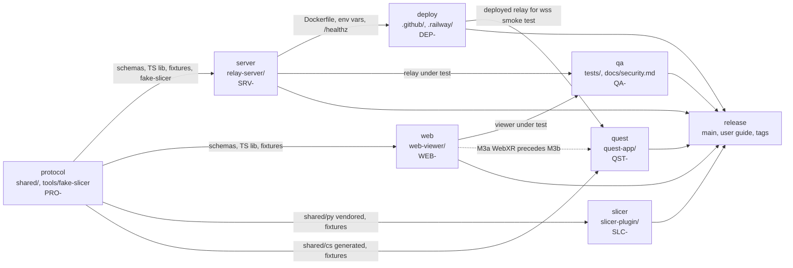

# SlicerRemoteView — implementation plan overview

Active milestone: M0

Status: v1, written by `architect` on 2026-10-17 (Phase D of `prompts/00-goal.md`). Owned by `release` on
`main` (CLAUDE.md rule 4): workstreams read this file, only `release` edits it. Component plans
(`docs/plan/<component>.md`) are owned by their workstreams. Requirements: `docs/requirements.md` (FR/NFR);
contract: `docs/protocol.md` v1.0; design and threat model: `docs/architecture.md`; decisions: `docs/adr/`.

## 1. How the plans work

- One task = one commit (≤ ~300 changed lines, working state, tests included) — CLAUDE.md rule 3 and
  `prompts/_workflow.md`. A task is `done` only with its test (automated, or manual steps in
  `docs/testing/<component>.md` when Slicer, a phone, a Quest or Railway is required — rule 10).
- Task IDs: `PRO-` protocol, `SRV-` server, `WEB-` web, `SLC-` slicer, `QST-` quest, `DEP-` deploy, `QA-` qa.
  `⚑` after an ID marks the critical path (section 4). Status values: `todo` / `doing` / `done`.
- A workstream works only on tasks of the **active milestone** (line 3 of this file) plus earlier unfinished
  ones. Tasks of later milestones may be started only with argument `plan` or when explicitly asked.
- Cross-component dependencies name real IDs. If a dependency is not `done` on `main` but can be faked inside
  the component, the task is marked `[stub allowed]` in its plan and the workstream records `[stub: <ID>]`
  when it does so; the stub is removed when the dependency lands.
- Protocol changes follow CLAUDE.md rule 2 (`docs/protocol.md` + version first, separate `docs(protocol):`
  commit, `[protocol change: vX.Y]` in affected plans). Nothing in M0–M3 changes the protocol; M4 stretch
  items (camera sync, telepointer) need v1.1 and an ADR.

## 2. Milestones

Milestone names used in every plan: `M0`, `M1`, `M2`, `M3a`, `M3b`, `M4`.

### M0 — Foundations

**Goal:** the contract is executable and every Node workspace builds and tests in CI; no end-to-end feature yet.

Definition of Done:

- [ ] JSON Schema for every message type in `docs/protocol.md` §11, with valid and invalid fixtures validated in
  TS and Python (FR-61, FR-62, FR-63, FR-66, FR-67).
- [ ] `tools/fake-slicer` creates a session and streams a fixture GLB through the chunk protocol against an
  in-process relay stub (FR-69).
- [ ] Sample GLB fixtures (asymmetric, two-node T/M structure, `extras.nodeId`) pass `gltf-validator`; broken
  fixtures exist for negative tests (FR-64, FR-65).
- [ ] Relay skeleton answers `GET /healthz` and `GET /api/version`; code generator passes alphabet and uniqueness
  tests; Docker image builds from the repository root (FR-19, FR-28, NFR-37, NFR-38).
- [ ] Web viewer toolchain builds an empty shell to `web-viewer/dist`; Slicer extension skeleton loads in Slicer
  with no network at import (FR-01, FR-02).
- [ ] GitHub Actions runs lint, typecheck, unit tests and the Docker build for every push; Python tests run for
  `shared/py` and `slicer-plugin` (NFR-39).

Tasks: PRO-01…PRO-14 · SRV-01, SRV-02, SRV-03, SRV-20 · WEB-01 · SLC-01, SLC-02 · DEP-01, DEP-02, DEP-03 · QA-01.

### M1 — MVP web

**Goal:** Slicer → relay → phone browser: type a code, see one model, rotate/zoom/pan, toggle nodes locally.

Definition of Done:

- [ ] "Start session" in Slicer shows a 5-character code within 3 s and sends the first snapshot (US-01, FR-03,
  FR-05, FR-07, FR-08, FR-13, FR-16).
- [ ] A phone typing the code sees the model within 10 s on 4G for a 10 MB GLB, with progress; the code never
  appears in a URL path or query (US-06, FR-35, FR-37, FR-38, FR-39, FR-40 visibility, FR-44, FR-50, NFR-01,
  NFR-15).
- [ ] Relay enforces one publisher, 20 viewers, rate limits and lockout, in-memory sessions with TTL, payload
  caps, uniform `INVALID_CODE`; logs contain no codes, tokens or payloads (FR-19…FR-26, FR-29, FR-31, FR-34,
  NFR-10, NFR-12, NFR-13).
- [ ] Late viewer receives the cached snapshot over `GET /api/scene/:sceneVersion` with a Bearer viewer token
  (FR-23, protocol §6.5, §10).
- [ ] Automated E2E (fake-slicer → relay → web viewer, iPhone and Pixel descriptors) and a relay log-grep test
  pass in CI; Railway IaC exists and the first deploy is verified manually (NFR-37, NFR-39).

Tasks: PRO-15 · SRV-04…SRV-11, SRV-14, SRV-16, SRV-18, SRV-22 · WEB-02…WEB-10 · SLC-03…SLC-10 ·
DEP-04, DEP-05, DEP-06, DEP-09, DEP-12 · QA-02, QA-03, QA-05, QA-07.

### M2 — Live scene

**Goal:** many models and segmentations, live visibility/colour/opacity/transform updates, late join with state,
reconnect and resume, QR deep link, decimation budgets and limits.

Definition of Done:

- [ ] Changes in Slicer reach every viewer within 500 ms (p95) without re-sending geometry; geometry changes
  produce a new snapshot (US-02, FR-06, FR-09…FR-12, FR-41, NFR-02).
- [ ] Late joiners match the presenter's state; viewers and the publisher reconnect automatically, the code stays
  valid across a relay redeploy (US-05, US-11, US-12, FR-14, FR-27, FR-30, FR-42, FR-43, FR-70, NFR-19…NFR-22).
- [ ] QR code and `/j#CODE` deep link join in one tap; the fragment is removed from the address bar (US-07, FR-04,
  FR-36, NFR-30).
- [ ] Device profiles and decimation budgets enforced in Slicer; oversized snapshots are refused with guidance
  (US-17, FR-10, FR-15, FR-17, FR-49, NFR-03, NFR-04, NFR-23).
- [ ] Viewer frees memory on new snapshots, survives WebGL context loss, keeps the screen awake, is installable
  as a PWA; bundle ≤ 1 MB gzipped (FR-45, FR-46, NFR-08, NFR-09).
- [ ] Negative tests for T1–T12 that can run without devices pass; load test with 20 viewers meets NFR-05;
  `docs/security.md` maps every threat to a test (NFR-18).

Tasks: PRO-16 · SRV-12, SRV-13, SRV-15, SRV-17, SRV-21 · WEB-11…WEB-18 · SLC-11…SLC-19 · DEP-07, DEP-08,
DEP-10 · QA-04, QA-06, QA-08, QA-09, QA-10.

### M3a — Quest WebXR

**Goal:** the web viewer runs in Meta Quest Browser as an immersive session with hands/controllers (ADR 0003).

Definition of Done:

- [ ] "Enter XR" starts `immersive-ar` (fallback `immersive-vr`) on Quest Browser; scene placed at 1.3 m, metres
  1:1; controller and hand models self-hosted (US-14, FR-47, NFR-27).
- [ ] Grab, rotate and scale the scene root with controllers or hands; Quest 2 budget warning (FR-48, NFR-04).
- [ ] Manual scenarios in `docs/testing/web.md` §Quest Browser pass on a Quest 2 and a Quest 3/3S (NFR-07).

Tasks: WEB-19, WEB-20 · QA-11. (Quest plan: no `QST-` tasks in M3a — see `docs/plan/quest.md` §M3a.)

### M3b — Quest native

**Goal:** Unity 6.3 LTS app on Quest 2/3/3S: keypad code entry, glTFast scene, hands/controllers manipulation,
passthrough, live updates, reconnect.

Definition of Done:

- [ ] `wss://` to the Railway relay works from an IL2CPP/ARM64 build, including a > 16 MiB snapshot (R-01, FR-54).
- [ ] Code entered on a 31-key world-space keypad; scene appears at 1.3 m at 1:1; one-hand move, two-hand
  rotate/scale clamped 0.1x–5x (US-15, FR-52, FR-53, FR-55, FR-56, FR-57).
- [ ] State updates apply within one frame; node panel; reconnect and error states as in the web viewer (FR-58,
  FR-59).
- [ ] Protocol parsing, nodeId mapping and transform conversion covered by EditMode tests; generated C# DTOs match
  the schema (FR-60, FR-62, NFR-39).
- [ ] 72 Hz on Quest 2 for the `quest2` profile; APK build and install documented (NFR-07, NFR-27).

Tasks: PRO-17 · QST-01…QST-16.

### M4 — Polish & release

**Goal:** operations, localisation, packaging, user documentation, first tagged release. Camera sync / telepointer
remain candidates (protocol v1.1 + ADR), not commitments (ADR 0004).

Definition of Done:

- [ ] `/metrics` behind a bearer token; Dependabot and audit jobs green; release workflow builds the Slicer
  extension zip from a tag (FR-32, NFR-34…NFR-37, T12).
- [ ] Slicer, web and Quest UIs in Polish and English (FR-18, FR-51, NFR-33).
- [ ] Extension packaged for the Slicer Extension Index with consent text and data-flow statement (NFR-16, R-06).
- [ ] User guide PL/EN in `docs/user-guide/`, `CHANGELOG.md`, versions aligned, tag `v1.0.0`
  (`prompts/08-integration-release.md`).
- [ ] Full regression suite runs with one command and gates the release.

Tasks: SRV-19 · WEB-21 · SLC-20, SLC-21 · DEP-11 · QA-12 (+ `release` steps from `prompts/08`).

## 3. Workstream dependency map

Reading the arrows: `protocol` unblocks everything; `server` and `web` can start in parallel with `protocol`
using stubs; `slicer` needs only `protocol` (vendored Python) and a relay to test against (fake relay stub or
`relay-server` on `main`); `deploy` needs the relay's Dockerfile; `qa` needs relay + viewer + fake-slicer on
`main`; `quest` starts in M3b after the WebXR mode (M3a) proved the Quest-side UX.

## 4. Critical path and parallelism

Critical path to the M1 demo (Slicer → relay → phone), in order; every ID below carries `⚑` in its plan:

1. `PRO-01 → PRO-02 → PRO-03 → PRO-04 → PRO-05 → PRO-06 → PRO-07 → PRO-08 → PRO-13 → PRO-14`
   (schemas, TS validation library, chunk codec, GLB fixtures, fake-slicer streaming a snapshot).
2. `SRV-04 → SRV-05 → SRV-06 → SRV-07 → SRV-09 → SRV-10 → SRV-11 → SRV-22`
   (registry, handshake, publisher, viewer join, snapshot ingest, fan-out, HTTP scene, integration test with
   fake-slicer). `SRV-08` (rate limit), `SRV-14` (heartbeat), `SRV-16` (static viewer), `SRV-18` (log redaction)
   are M1 but off the path.
3. `WEB-02 → WEB-03 → WEB-04 → WEB-05 → WEB-06 → WEB-07 → WEB-08 → WEB-09 → WEB-10`
   (errors catalogue, code entry, ws client, reassembly, HTTP fetch, GLTF parse + nodeId map, controls, node
   panel, Playwright mobile smoke).
4. `SLC-03 → SLC-04 → SLC-05 → SLC-06 → SLC-07 → SLC-08 → SLC-09`
   (vendoring, GLB writer, coordinates, protocol client, MRML collection, IO thread, UI with first snapshot).
5. `QA-02 → QA-03` (harness and happy-path E2E) → manual E2E with a real Slicer (`docs/testing/slicer.md` §M1)
   → `release M1`.

Compact form: PRO-01 → … → PRO-14 → SRV-05 → … → SRV-22 → WEB-04 → … → WEB-10 → QA-03 → SLC-09 → release M1.

Parallelism per milestone:

| Milestone | Can run in parallel | Must wait |
|---|---|---|
| M0 | `protocol` (PRO-01…14); `server` SRV-01…03, SRV-20 with `[stub: PRO-06/07]`; `web` WEB-01; `slicer` SLC-01, SLC-02; `deploy` DEP-01…03; `qa` QA-01 | DEP-03 waits for SRV-20; PRO-13/14 wait for PRO-06…08 |
| M1 | `server` SRV-04…11 and `web` WEB-02…09 side by side (web uses PRO-13 relay stub until SRV-22); `slicer` SLC-03…08 (pure Python) alongside; `deploy` DEP-04/05/09/12 | WEB-10 and QA-03 wait for SRV-22 on `main`; SLC-09/10 need a relay (fake stub or SRV-07+); DEP-06 is a manual first deploy after DEP-04 |
| M2 | `server` SRV-12/13/15/17/21; `web` WEB-11…18; `slicer` SLC-11…19; `deploy` DEP-07/08 | WEB-12/14 may stub SRV-12/13/15; QA-04/06/08 wait for the server and web tasks they test; DEP-10 waits for QA-02/05 |
| M3a | `web` WEB-19/20; `qa` QA-11 | device testing on Quest 2 and 3 (manual) |
| M3b | `protocol` PRO-17 then `quest` QST-01…16 | QST-02 (wss smoke) needs DEP-06 (a deployed relay); QST-03 needs PRO-17 |
| M4 | SRV-19, WEB-21, SLC-20/21, DEP-11, QA-12 all independent | `release` steps (user guide, tag) last |

## 5. Integration rules (`release`)

1. **Branches and PRs.** Each workstream works on `ws/<component>` and opens one PR per run to `main`
   (title lists task IDs). Merge order per milestone: `protocol → server → web → slicer → quest → deploy → qa`
   (`prompts/08-integration-release.md`). Rebase on `main` before merge; conflicts in `docs/protocol.md` stop
   the merge and go to the user (`PYTANIE DO UŻYTKOWNIKA`).
2. **Release checks before closing a milestone.** All tasks of the milestone are `done` in every plan (or
   explicitly moved to the next milestone with a note); the DoD boxes of section 2 are ticked with evidence (CI
   run, E2E run, manual test entry in `docs/testing/<component>.md` with date and version); `npm run build`,
   `npm test`, `npm run lint` green at the repo root; Docker image builds; no open `high` report in
   `docs/testing/reports/`; `docs/testing/reports/*` entries all have an owner (`triaged`, `fixed` or `rejected`).
3. **Moving `Active milestone`.** `release` edits line 3 of this file (`Active milestone: M1`), adds the closing
   date to the milestone heading (e.g. `### M0 — Foundations (closed 2026-11-02)`), carries unfinished tasks
   forward in the component plans, and commits as `docs(plan): close M0, open M1`. Workstreams parse the line
   with `grep -m1 '^Active milestone:' docs/plan/00-overview.md`.
4. **Updates to shared documents.** Only `release` edits `CLAUDE.md`, this file, `docs/architecture.md`,
   `docs/requirements.md`; discrepancies found by workstreams are reported in the PR description or in
   `docs/testing/reports/`. Known items for `release` at the time of writing: `docs/requirements.md` FR-13 and
   FR-63 still use pre-contract message names (`create_session`, `end_session`, `scene_reset`) — the protocol
   names (`session.create`, `session.close`, new snapshot after scene close) are authoritative; FR-26/NFR-13 say
   lockout 15 min while `docs/protocol.md` §12 says 10 min (plans follow the protocol); ADR 0008 specifies a
   10-minute code quarantine while `docs/architecture.md` §3 says "no cooldown" (plans implement the quarantine,
   configurable).
5. **Reports.** Bugs in another component go to `docs/testing/reports/<date>-<reporter>-<n>.md`; the owner
   triages at its next start (CLAUDE.md rule 9).

## 6. Plan files

| Plan | Component | Branch | Tasks | M0 | M1 | M2 | M3a | M3b | M4 |
|---|---|---|---|---|---|---|---|---|---|
| `docs/plan/protocol.md` | `protocol` | `ws/protocol` | 17 | 14 | 1 | 1 | 0 | 1 | 0 |
| `docs/plan/server.md` | `server` | `ws/server` | 22 | 4 | 12 | 5 | 0 | 0 | 1 |
| `docs/plan/web.md` | `web` | `ws/web` | 21 | 1 | 9 | 8 | 2 | 0 | 1 |
| `docs/plan/slicer.md` | `slicer` | `ws/slicer` | 21 | 2 | 8 | 9 | 0 | 0 | 2 |
| `docs/plan/quest.md` | `quest` | `ws/quest` | 16 | 0 | 0 | 0 | 0 | 16 | 0 |
| `docs/plan/deploy.md` | `deploy` | `ws/deploy` | 12 | 3 | 5 | 3 | 0 | 0 | 1 |
| `docs/plan/qa.md` | `qa` | `ws/qa` | 12 | 1 | 4 | 5 | 1 | 0 | 1 |
| **Total** | | | **121** | 25 | 39 | 31 | 3 | 17 | 6 |

## 7. Retro

(Filled by `release` at each milestone close: what slowed us down, what to change in plans or prompts.)
